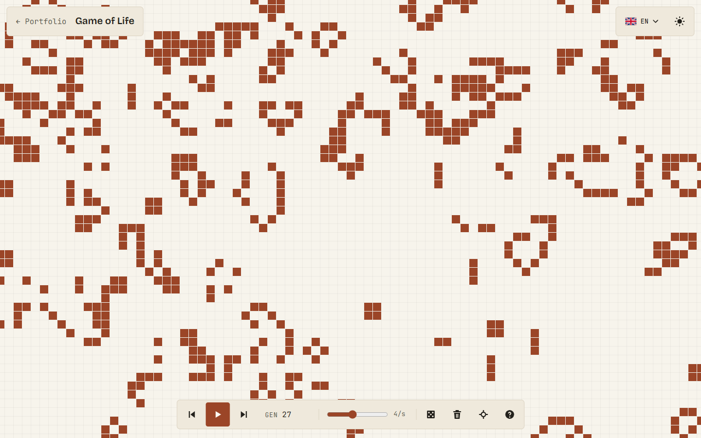

# Game of Life

Conway's Game of Life on an infinite board, in the browser. Draw cells with the mouse or a finger,
press play, step back and forth through time, zoom and pan freely.

**Play it at [life.leonard-fontaine.com](https://life.leonard-fontaine.com)**: a small showcase
project from [leonard-fontaine.com](https://leonard-fontaine.com).

<picture>
  <source media="(prefers-color-scheme: dark)" srcset="docs/images/screenshot-dark.png" />
  
</picture>

## Features

- **Infinite board** with zoom and pan; a time budget keeps the page smooth even near the
  50,000-cell limit.
- **Drawing by gestures**, no mode button: the first cell touched decides whether a stroke paints
  or erases.
- **Timeline**: play, pause, step forward and back through the last 100 states (stepping back also
  undoes drawing), adjustable speed from 1 to 30 generations per second.
- Random fill, clear, recenter, and a help panel that shows shortcuts on a computer and gestures on
  a touch screen.
- **French, English and Dutch**, light and dark themes, keyboard shortcuts, screen reader labels,
  WCAG AA contrast, reduced motion and high contrast honoured.
- **Private by design**: no tracker, no analytics, no cookie, no third-party request. Fonts are
  self-hosted and the page runs under a strict Content Security Policy.

| Action          | Mouse and keyboard                           | Touch screen |
| --------------- | -------------------------------------------- | ------------ |
| Draw, erase     | Click, drag                                  | Tap, drag    |
| Move around     | <kbd>Space</kbd> + drag, middle drag, arrows | Two fingers  |
| Zoom            | Wheel, <kbd>+</kbd> <kbd>−</kbd>             | Pinch        |
| Play / pause    | <kbd>K</kbd>, <kbd>Space</kbd>               | Play button  |
| Previous / next | <kbd>J</kbd> / <kbd>L</kbd>                  | Buttons      |
| Recenter, help  | <kbd>0</kbd>, <kbd>?</kbd>                   | Buttons      |

## Run it locally

Requires [Node.js](https://nodejs.org) 22.12 or newer.

```sh
npm ci            # install the exact dependency versions from package-lock.json
npm run dev       # start the dev server on http://localhost:5173
```

| Command                | What it does                                                     |
| ---------------------- | ---------------------------------------------------------------- |
| `npm test`             | Unit tests (Vitest); add `-- --coverage` for the coverage report |
| `npm run lint`         | Lint (oxlint)                                                    |
| `npm run format:check` | Check formatting (Prettier)                                      |
| `npm run build`        | Type-check, then build the static site into `dist/`              |
| `npm run preview`      | Serve `dist/` with the production security headers               |

## Stack

TypeScript (strict) and [Vite](https://vite.dev), drawing on a Canvas 2D, with no framework.
Vitest for the tests, oxlint and Prettier for code quality, native CSS with custom properties, and
the fonts from [Fontsource](https://fontsource.org) (Google Sans, Bricolage Grotesque, JetBrains
Mono).

The rules engine ([`src/engine/life.ts`](src/engine/life.ts)) is a pure function written test-first:
it counts neighbours in a flat grid for compact patterns and in a map for patterns spread far
apart. Specifications and plans live in [`specs/`](specs) and [`tasks/`](tasks); deployment
requirements in [`docs/deployment-checklist.md`](docs/deployment-checklist.md).

## Licence

© Léonard Fontaine. All rights reserved.
